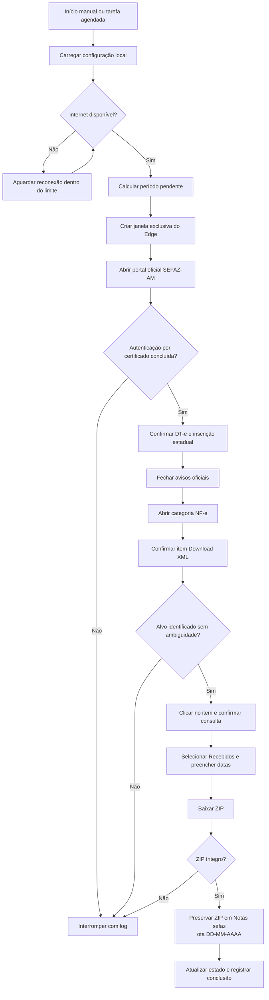
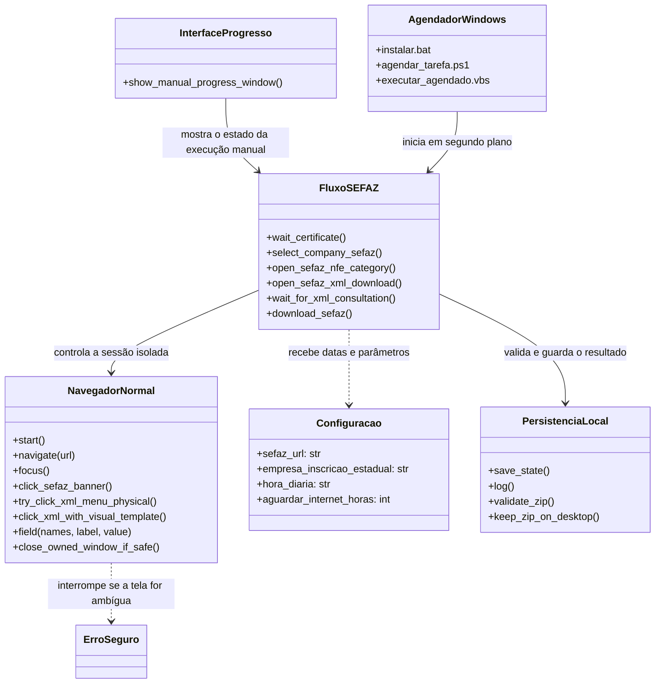
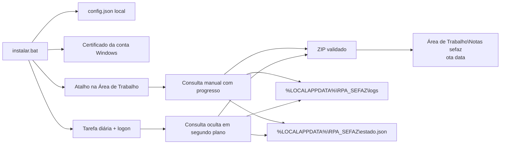

# Arquitetura da automação

## Responsabilidade do sistema

A aplicação autentica no DT-e com o certificado instalado na conta Windows, seleciona a inscrição estadual configurada, abre a consulta de XML recebidos, informa o período, baixa o ZIP, valida o arquivo e o guarda na pasta diária. A execução manual apresenta progresso; a execução agendada usa o Edge sem janela visível.

O fluxo de negócio termina no ZIP local. O código não encaminha arquivos ao Sankhya.

## Fluxo principal

## Componentes e relações

O diagrama mostra qual parte controla o navegador, qual conduz as etapas da SEFAZ e onde ficam os resultados locais. O fluxo manual exibe o progresso; o Agendador do Windows inicia a mesma consulta em segundo plano.

`NavegadorNormal` opera apenas a janela criada pela automação e deixa as janelas pessoais do usuário intactas. As funções de consulta confirmam cada tela antes de avançar; `ErroSeguro` encerra o fluxo quando o alvo ou a página não podem ser identificados. Os endereços, a inscrição estadual, os horários e os limites vêm da configuração local.

## Organização dos módulos

| Caminho | Papel |
|---|---|
| `aplicativo/download_sefaz_xml.py` | Orquestração, classe `NavegadorNormal`, rotinas de domínio, validação e interface manual. |
| `aplicativo/config.json` | Modelo genérico da configuração local. |
| `aplicativo/instalar.bat` e scripts PowerShell | Preparação da conta, certificado, cópia do EXE e tarefa diária. |
| `aplicativo/gerar_executavel.bat` | Instala dependências no ambiente isolado e compila o EXE. |
| `aplicativo/executar_*.bat` e `*.vbs` | Inicialização manual ou agendada sem abrir um console visível. |
| `aplicativo/acessarDTe.png` e `xml_item_template.png` | Referências visuais usadas para identificar alvos oficiais do portal. |

## Ciclo de vida e arquivos locais

