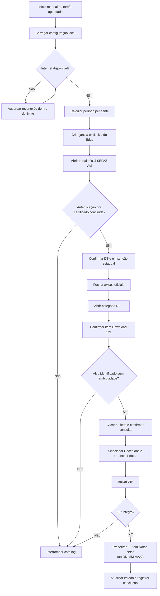
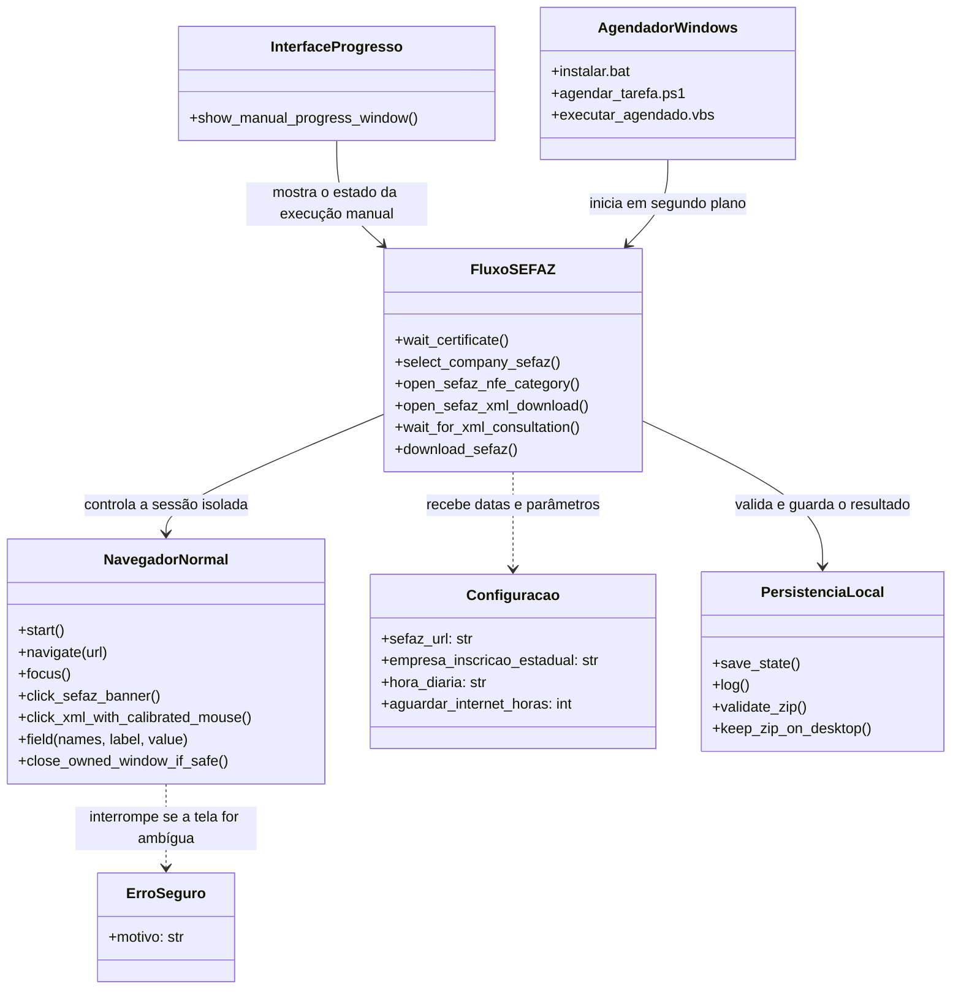
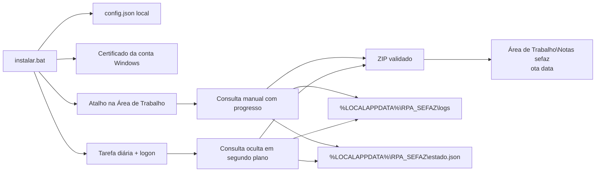

# Arquitetura da automação

## Responsabilidade do sistema

A aplicação autentica no DT-e com o certificado instalado na conta Windows, seleciona a inscrição estadual configurada, abre a consulta de XML recebidos, informa o período, baixa o ZIP, valida o arquivo e o guarda na pasta diária. A execução manual apresenta progresso; a execução agendada usa o Edge sem janela visível.

O fluxo de negócio termina no ZIP local. O código não encaminha arquivos ao Sankhya.

## Fluxo principal

## Modelo orientado a objetos

O núcleo concentra a automação em uma classe de infraestrutura e funções de domínio pequenas. Essa divisão dá um ponto claro para substituir ou depurar a interação com o Edge sem misturar cada passo de negócio com o agendamento.

### Princípios de projeto aplicados

- **Encapsulamento:** `NavegadorNormal` mantém a janela criada pela automação e suas operações, sem manipular as janelas pessoais do usuário.
- **Responsabilidade única:** funções separadas calculam períodos, validam o ZIP, registram o estado, identificam o painel e operam a consulta.
- **Abstração:** o fluxo de negócio chama métodos como `field` e `click_sefaz_banner`, sem repetir detalhes de teclado, DPI e UI Automation.
- **Falha segura:** `ErroSeguro` interrompe a rotina quando o alvo não é único, a página não corresponde ao domínio/caminho esperado ou o clique não pode ser confirmado.
- **Injeção de configuração:** URL, inscrição, horários e limites são lidos de `config.json`, em vez de ficarem fixos no fluxo.

## Organização dos módulos

| Caminho | Papel |
|---|---|
| `aplicativo/download_sefaz_xml.py` | Orquestração, classe `NavegadorNormal`, rotinas de domínio, validação e interface manual. |
| `aplicativo/config.json` | Modelo genérico da configuração local. |
| `aplicativo/instalar.bat` e scripts PowerShell | Preparação da conta, certificado, cópia do EXE e tarefa diária. |
| `aplicativo/gerar_executavel.bat` | Instala dependências no ambiente isolado e compila o EXE. |
| `aplicativo/executar_*.bat` e `*.vbs` | Inicialização manual ou agendada sem abrir um console visível. |
| `aplicativo/acessarDTe.png` e `xml_item_template.png` | Referências visuais usadas para identificar alvos oficiais do portal. |

## Ciclo de vida e arquivos locais

